  

  
  
  
  
  

---

### 👋 Hey, I'm Vamsi Avinash Gunji (Avi)

I got into DevOps by asking one question: **what happens after the code is written?** Seven-plus years later I build and run cloud platforms across **AWS, Azure and GCP** for banks, trading desks, retail and insurance — Terraform that other teams build on, release pipelines that ship without downtime, and automation for anything I've had to do twice.

- 🏦 **Now:** Senior DevOps Engineer / SRE at **Bank of America** — OpenShift platform, Terraform + Ansible automation, blue-green and A/B releases, Splunk & Dynatrace observability
- ☁️ **Clouds I've run in production:** AWS (EKS, ROSA, EC2, CodePipeline) · Azure (AKS, Azure DevOps, a cost-cutting migration) · GCP (GKE, Rundeck automation)
- 🔐 **Also in the toolbelt:** Vault & certificate automation, Jenkins / GitHub Actions / Argo CD / Spinnaker, Artifactory, Splunk, Datadog, Prometheus
- 🤝 **Open to collaborating on:** platform engineering, multi-cloud IaC, release automation, observability
- 🎥 **Off the clock:** former freelance videographer, graph-theory nerd, and owner of an adorable puppy

  

---

### 🚀 Work history

  

<b>📜 Work Experience </b> — click a release to expand

 

<code>v9.0</code> &nbsp;<b>Bank of America</b> · Senior DevOps Engineer · Nov 2025 – present

- Run 25+ microservice apps on OpenShift/Kubernetes; deployment speed and reliability up 30%
- Automated infrastructure with Terraform, Ansible and Python, cutting manual intervention by 70%
- Designed blue-green and A/B release strategies for zero-downtime upgrades of critical workloads
- Integrated Ansible Tower for workflow orchestration, cutting operational overhead by 40%
- Improved observability with Splunk and Dynatrace; detection and resolution times down 50%

<code>v8.0</code> &nbsp;<b>Goldman Sachs</b> · Senior DevOps Engineer · May – Oct 2025

- Automated SSL/TLS certificate renewals with Vault integration — 80% less manual effort, no expiry outages
- Built Splunk ingestion and centralized log pipelines across Linux fleets; troubleshooting 60% faster
- Refactored Terraform into reusable modules and wrappers, and rebuilt a lost repo by reverse-engineering live infra — provisioning errors down 40%, costs down 25%
- Automated blue-green releases for trading apps (Mosaic, GTAM) with a cherry-pick release-candidate branch strategy; release cycles 35% shorter

<code>v7.0</code> &nbsp;<b>Bank of America</b> · DevOps Engineer · Nov 2023 – May 2025

- Managed OpenShift and Kubernetes clusters for 50+ applications
- Jenkins + JFrog Artifactory CI/CD pipelines with Aqua container scanning; deploy time down 45%
- Terraform modules integrated with Vault; Argo CD rollout with GitOps
- Led migration to Azure, reducing infrastructure costs by 30%

<code>v6.0</code> &nbsp;<b>PwC</b> · DevOps Engineer · Jun – Nov 2023

- GitHub Actions pipeline that auto-remediates Kubernetes clusters via microservice APIs
- Real-time task status via webhooks, callbacks and async DB calls
- Reusable Terraform templates for AKS; Skaffold for faster dev loops

<code>v5.0</code> &nbsp;<b>State Street</b> · Platform Engineer · May – Jul 2023

- Provisioned AKS clusters with Terragrunt + Terraform and reusable modules
- Azure DevOps pipelines for automated cloud resource provisioning

<code>v4.0</code> &nbsp;<b>The Home Depot</b> · Site Reliability Engineer II · Dec 2022 – May 2023

- Built on-prem Rundeck platform automating across GCP with Ansible, Kubernetes and Docker
- Centralized job scheduling through Rundeck; team velocity up 40%
- Ansible-based disaster recovery to rebuild Rundeck, restore volumes and self-heal pods
- Prometheus + Grafana monitoring for Rundeck

<code>v3.0</code> &nbsp;<b>Farmers Insurance</b> · DevOps Engineer · Jan – Dec 2022

- Onboarded apps to Red Hat OpenShift across 9+ clusters, including ROSA on AWS
- Argo CD workflows for OpenShift; JFrog Artifactory + Xray on EC2
- Gremlin chaos testing to harden nodes, cutting cluster vulnerabilities by 65%

<code>v2.0</code> &nbsp;<b>Clarivate</b> · Software Engineer → DevOps Engineer · Jan 2019 – Dec 2021

- Integrated components into the Smart Search system with Shell/AWK automation
- Python and Julia automation for the Smart Themes semantic database, extended to German, French and Latin

<code>v1.0</code> &nbsp;<b>Seton Hall University</b> · BS Computer Science + BS Mathematics · 2016 – 2020

- Graduated Cum Laude · Dean's List ×4 · graph-theory and graph-toughness research
- Math teaching assistant: built data-analysis tools tracking 200+ students
- Later: MS Business Analytics, Trine University (2024) — Summa Cum Laude

---

### 🧰 Toolbox

<table>
<tr><td><b>Cloud</b></td><td> </td></tr>
<tr><td><b>Containers</b></td><td>  </td></tr>
<tr><td><b>IaC &amp; Config</b></td><td>  </td></tr>
<tr><td><b>CI/CD</b></td><td>    </td></tr>
<tr><td><b>Observability</b></td><td>    </td></tr>
<tr><td><b>Code</b></td><td></td></tr>
</table>

---

### 🏅 Certifications

  
   Click to verify credentials on LinkedIn

---

### ⌨️ Languages

  

---

### 💬 Ask me about

<b>How do you ship to production with zero downtime?</b>

 
Blue-green for anything stateful or customer-facing, A/B when we need to measure. The release candidate is cut from main with cherry-picks so only reviewed changes ride the train, traffic shifts gradually, and rollback is a router flip — not a redeploy.

<b>What happened when the Terraform repo was lost?</b>

 
Reverse-engineered it from live infrastructure: imported resources back into state, rebuilt the code as reusable modules with thin wrappers per environment, then used the clean codebase to safely decommission what nobody needed. Errors went down 40%, cloud spend 25%.

<b>AWS or Azure?</b>

 
Both, plus GCP. ROSA and EKS on AWS at Farmers, GKE with Rundeck at Home Depot, AKS everywhere from State Street to PwC to Bank of America — including a migration to Azure that cut infrastructure cost by 30%. I pick the cloud the business already trusts and keep the Terraform portable.

<b>Why does a math major do DevOps?</b>

 
Infrastructure is a graph — services are nodes, dependencies are edges, and an outage is a cut set. Years of graph-theory research turned out to be decent SRE training.

<b>Imposter syndrome?</b>

 
I wrote about it: <a href="https://www.linkedin.com/pulse/do-you-know-i-suffered-from-imposter-syndrome-what-taught-gunji/">Do you know I suffered from imposter syndrome? What it taught me</a>

---

### 🤝 Let's connect

  

Thanks for stopping by — check out the repos below, or <a href="mailto:info@vamsiavinashgunji.com">drop me a line</a>.

